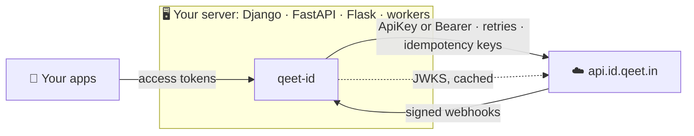

<div align="center">

# 🐍 Qeet ID for Python

**The server-side Python SDK for Qeet ID: manage an organisation's people and access, verify webhooks and access tokens, and run OAuth flows from Python.**

[](#-install)
[](#-typing)
[](#-quick-start)
[](pyproject.toml)
[](tests)
[](#-oauth)

[🌐 Qeet ID](https://id.qeet.in) · [📖 Docs](https://docs.qeet.in) · [🚀 Quick start](#-quick-start) · [🧭 Resources](#-resources) · [📝 Changelog](CHANGELOG.md) · [🟢 Node SDK](https://github.com/qeetgroup/qeet-id-node) · [🐹 Go SDK](https://github.com/qeetgroup/qeet-id-go)

</div>

> [!IMPORTANT]
> Use it on servers only. It authenticates with a secret API key or client secret that must never reach a browser.

## 📦 What's inside

| | |
|:--|:--|
| 🧭 **Typed clients** | `QeetID` and `AsyncQeetID`, the same 38 resource namespaces and **269 API calls**, each checked against the server's OpenAPI documents. Every request and response is a typed dict |
| 🚨 **Typed errors** | A `QeetIDError` hierarchy: one class per HTTP status, `SessionRevokedError`, `OAuthError`, `NetworkError`, `RequestTimeoutError`. Each carries the stable `code`, the `request_id` and `retry_after` |
| 🔁 **Safe retries** | Exponential backoff with jitter and `Retry-After`, only for requests that can't act twice. An `Idempotency-Key` sent automatically on the nine creates the API makes idempotent |
| 📄 **Pagination** | `for` (or `async for`) walks every item across pages; whole lists come as `ListResult` with `truncated` |
| 🔐 **Two credentials** | An API key, or a service principal's client ID and secret, exchanged for a cached, renewed token |
| 🪝 **Webhooks** | Timestamped HMAC-SHA256 verification in constant time, two secrets during a rotation, a five-minute replay window, typed events |
| 🔑 **Access tokens** | Local ES256 verification against the issuer's keys, with a required issuer and audience, a JWKS cache that rides out outages |
| 🤝 **OAuth** | Client credentials (with `expires_in`), code exchange, refresh, token exchange, device and CIBA polling, introspection, revocation, a token guard |
| 🪶 **Lean** | Three runtime dependencies: `httpx2`, `anyio` and `cryptography`. No pydantic, no JWT library |

## 🔗 How it fits



| SDK | Language | Role |
|:--|:--|:--|
| **`qeet-id`** | Python | This package: the API, webhooks, tokens and OAuth from Python servers |
| [`@qeet-id/node`](https://github.com/qeetgroup/qeet-id-node) | Node.js / TypeScript | The same for Node.js |
| [`qeet-id-go`](https://github.com/qeetgroup/qeet-id-go) | Go | The same for Go |

## 📥 Install

Python 3.11 or later; tested on 3.11, 3.12, 3.13, 3.14 and 3.15.

```sh
pip install qeet-id
# or: uv add qeet-id · poetry add qeet-id
```

## 🚀 Quick start

Create an API key in the Qeet ID console and keep it in a secret store.

```python
import os

from qeet_id import QeetID

client = QeetID(api_key=os.environ["QEET_ID_API_KEY"])
tenant_id = os.environ["QEET_ID_TENANT_ID"]

user = client.users.create(
    tenant_id=tenant_id,
    email="meera@brightleaffoods.in",
    display_name="Meera Iyer",
)
client.roles.assign(tenant_id, user["id"], finance_role_id)

allowed = client.permissions.check(user_id=user["id"], tenant_id=tenant_id, permission="invoice.approve")
```

The same with `asyncio` (or trio):

```python
from qeet_id import AsyncQeetID

async with AsyncQeetID(api_key=os.environ["QEET_ID_API_KEY"]) as client:
    user = await client.users.get(user_id)
    async for member in client.users.list(status="active"):
        print(member["email"])
```

Create one client per process and share it: it is safe across threads (sync) or tasks (async), and reuses
connections and cached tokens. Use it as a context manager, or call `close()`, to release its connections.

### Machine credentials

A service principal's client ID and secret work in place of an API key. The client gets an access token with the
client-credentials grant, caches it, and renews it a minute before it expires; concurrent calls share one fetch.

```python
client = QeetID(
    client_id=os.environ["QEET_ID_CLIENT_ID"],
    client_secret=os.environ["QEET_ID_CLIENT_SECRET"],
)
```

## ⚙️ Configuration

```python
client = QeetID(
    api_key=os.environ["QEET_ID_API_KEY"],
    timeout=30.0,
    max_retries=2,
    app_info={"name": "brightleaf-onboarding", "version": "1.4.0"},
    default_headers={"X-Team": "people-ops"},
)
```

| Option | Default | |
|:--|:--|:--|
| `api_key` | none | Sent as `Authorization: ApiKey <key>` |
| `client_id`, `client_secret` | none | A service principal's credentials, instead of `api_key` |
| `base_url` | `https://api.id.qeet.in` | Must be `https`; plain `http` only for `localhost`, `*.localhost` and loopback addresses |
| `timeout` | `30.0` | Seconds each attempt may wait to connect, send or read; or an `httpx2.Timeout` |
| `max_retries` | `2` | Retries after a transient failure, for retry-safe requests only; `0` turns them off |
| `default_headers` | none | Sent on every request; can't replace `Authorization`, `Accept`, `Content-Type`, `User-Agent` or `Idempotency-Key` |
| `app_info` | none | `{"name", "version", "url"}`, put in front of the User-Agent |
| `http_client` | a new one | An `httpx2.Client` (or `httpx2.AsyncClient`) of your own, for a proxy, custom TLS or tests. Never closed by the SDK |

Every method takes `request_options` last, overriding the client for that call:

```python
client.users.get(user_id, request_options={"timeout": 5.0, "max_retries": 0, "headers": {"traceparent": trace}})
```

## 🧭 Resources

Identifiers come first and positionally; request bodies and filters are keyword arguments with the API's field
names. Responses are typed dicts with the API's field names too (`user["display_name"]`, `user["created_at"]`).

| Area | Namespaces |
|:--|:--|
| 👥 **Identity** | `tenants` (the organisation) · `domains` · `users` · `groups` · `invitations` · `branding` |
| 🛡️ **Access** | `roles` · `permissions` · `relationships` (ReBAC tuples) · `decisions` (OpenID AuthZEN) · `auth_policies` · `security_policies` · `ip_rules` · `threat_detection` (bots, risk, anomalies) |
| 🌐 **Federation** | `oauth` · `applications` (OAuth/OpenID clients and RFC 8707 resources) · `service_principals` · `saml_connections` · `saml_service_providers` · `ldap_connections` · `scim` · `social_providers` · `admin_portal_links` |
| 🛠️ **Developer** | `api_keys` · `agents` · `verifiable_credentials` · `auth_hooks` · `webhooks` · `secrets` · `token_vault` |
| 📊 **Operations** | `audit_logs` · `analytics` · `billing` · `gdpr` · `email_templates` · `retention` · `log_sinks` · `rate_limits` |

```python
page = client.audit_logs.list(tenant_id, action="user.deleted", from_="2026-11-01T00:00:00Z")
client.webhooks.update(tenant_id, webhook_id, events=["user.created", "user.deleted"])
rotated = client.webhooks.rotate_secret(tenant_id, webhook_id)
secrets = client.secrets.list(tenant_id)  # ListResult: iterate it; secrets.truncated says if the API capped it
```

A field named after a Python keyword takes a trailing underscore and is sent without it: `from_` is `from`.

The SDK covers the calls an API key may make. A person's own account (their sessions, factors, passkeys, email
changes) is theirs to manage through the hosted pages. What isn't wrapped yet is listed in
[docs/FUTURE.md](docs/FUTURE.md).

## 🚨 Errors

Every failure is raised. Catch the class, or branch on `code`, never on the message.

| Class | When | Worth reading |
|:--|:--|:--|
| `BadRequestError` | 400 | `code`, `detail` |
| `AuthenticationError` | 401 | `code` |
| ↳ `SessionRevokedError` | 401 `auth.session_revoked` | sign in again; never retried |
| `PaymentRequiredError` | 402 | `code`: the plan doesn't include it, or a limit is reached |
| `PermissionDeniedError` | 403 | `code` |
| `NotFoundError` | 404 | |
| `ConflictError` | 409 | `code`, such as `idempotency.outcome_unknown` |
| `ValidationError` | 422 | `fields`: each field's `code` and `message` |
| `RateLimitError` | 429 | `retry_after` |
| `InternalServerError` | 5xx | `request_id` |
| ↳ `ServiceUnavailableError` | 503 | `retry_after` |
| `OAuthError` | an OAuth endpoint refused | `code` is the RFC 6749 `error`, such as `invalid_grant` |
| `NetworkError` · `RequestTimeoutError` | no response, or none in time | `__cause__` |
| `WebhookVerificationError` | a delivery failed verification | `code`, such as `signature_mismatch` |
| `TokenVerificationError` | an access token failed verification | `code`, such as `token_expired` |

All of them extend `QeetIDError`; the API ones extend `APIError`, which also has `status`, `request_id` (quote it to
support), `detail`, `metadata`, `retryable`, `retry_after` and `headers`.

```python
from qeet_id import ConflictError, RateLimitError, ValidationError

try:
    client.users.create(tenant_id=tenant_id, email=email)
except ValidationError as error:
    for field in error.fields:
        print(field.field, field.code, field.message)
except ConflictError as error:
    if error.code != "user.domain_managed_elsewhere":
        raise
except RateLimitError as error:
    print(f"retry in {error.retry_after} s, request {error.request_id}")
```

A mistake in your own arguments (an empty identifier, a malformed idempotency key, a reserved header) is a
`ValueError` or `TypeError`, raised before anything is sent.

## 🔁 Retries & timeouts

| | |
|:--|:--|
| ✅ **Retried** | `GET` and `DELETE`; POSTs that change nothing (permission and relationship checks, AuthZEN evaluations, previews, introspection, revocation, the client-credentials grant); requests carrying an `Idempotency-Key` |
| ⚡ **After** | no response, a timeout, `408`, `429`, `500`, `502`, `503`, `504`, `409 idempotency.in_progress` |
| ⛔ **Never** | `PUT`, `PATCH` and other POSTs; single-use OAuth grants; directory sign-in (counts toward the lockout); any `401`, so never `auth.session_revoked`, whatever the server's `retryable` hint says |
| ⏱️ **Waits** | the server's `Retry-After` up to 60 s (a longer one is raised as is), otherwise 0.5 s doubling to 8 s with jitter |

Each attempt has its own `timeout`. To bound a whole call, retries included, wrap it: `anyio.fail_after(10)` on the
async client.

### 🔂 Idempotency

`users.create`, `groups.create`, `invitations.create`, `service_principals.create`, `api_keys.create`,
`agents.create`, `webhooks.create`, `billing.checkout` and `billing.pay_invoice` always send an `Idempotency-Key`:
one generated per call, so the SDK's own retries never create twice. Pass your own to make retries across calls,
deployments or processes safe too:

```python
client.users.create(
    tenant_id=tenant_id,
    email="meera@brightleaffoods.in",
    idempotency_key=f"onboarding-{employee.id}",  # 1 to 255 printable ASCII characters
)
```

The API keeps the answer for 24 hours. The same key with another body is refused (`422 idempotency.key_reused`);
`409 idempotency.outcome_unknown` means the first request was interrupted: check whether it took effect before
trying again with a new key.

## 📄 Pagination

Paged lists (users, audit log, consent grants, SCIM users and groups, anomalies, decisions, webhook deliveries,
relationship objects) iterate across every page:

```python
for user in client.users.list(status="active", limit=100):
    print(user["email"])

page = client.users.list(limit=50)  # one page
page.data, page.next_cursor
if page.has_next_page():
    page = page.get_next_page()
for p in page.iter_pages():
    print(len(p.data))
```

On the async client, `list()` is awaitable for one page and `async for` walks them all:

```python
page = await client.users.list(limit=50)
async for user in client.users.list(status="active"):
    ...
```

Other lists come whole as a `ListResult`: iterate it, index it, take its `len()`; `truncated` is `True` when the API
capped the list.

## 🪝 Webhooks

Each delivery is a signed POST whose body is an event:

```json
{"id": "…", "type": "user.created", "tenant_id": "…", "occurred_at": "2026-11-05T09:30:00Z", "data": {…}}
```

`construct_webhook_event` checks `X-Qeet-Signature` (`sha256=` and the HMAC-SHA256 of `X-Qeet-Timestamp`, `.` and
the raw body) in constant time, refuses a delivery signed more than five minutes from now, and returns the event. It
needs no client and no API key. Always pass the **raw** body: a parsed and re-serialised one won't match.

**Django**

```python
from django.conf import settings
from django.http import HttpRequest, HttpResponse
from django.views.decorators.csrf import csrf_exempt
from django.views.decorators.http import require_POST

from qeet_id import WebhookVerificationError, construct_webhook_event


@csrf_exempt
@require_POST
def qeet_id_webhook(request: HttpRequest) -> HttpResponse:
    try:
        event = construct_webhook_event(request.body, request.headers, settings.QEET_ID_WEBHOOK_SECRET)
    except WebhookVerificationError as error:
        return HttpResponse(error.code, status=400)
    if already_handled(event["id"]):  # deliveries can repeat
        return HttpResponse(status=204)
    if event["type"] == "user.deleted":
        remove_local_data(event["data"])
    return HttpResponse(status=204)
```

**FastAPI**

```python
from fastapi import FastAPI, HTTPException, Request, Response

from qeet_id import WebhookVerificationError, construct_webhook_event

app = FastAPI()


@app.post("/webhooks/qeet-id", status_code=204)
async def qeet_id_webhook(request: Request) -> Response:
    try:
        event = construct_webhook_event(await request.body(), request.headers, WEBHOOK_SECRET)
    except WebhookVerificationError as error:
        raise HTTPException(status_code=400, detail=error.code) from error
    await handle(event)
    return Response(status_code=204)
```

**Flask**

```python
from flask import Flask, abort, request

from qeet_id import WebhookVerificationError, construct_webhook_event

app = Flask(__name__)


@app.post("/webhooks/qeet-id")
def qeet_id_webhook():
    try:
        event = construct_webhook_event(request.get_data(), request.headers, WEBHOOK_SECRET)
    except WebhookVerificationError as error:
        abort(400, error.code)
    handle(event)
    return "", 204
```

| | |
|:--|:--|
| 🔄 **Rotating the secret** | `webhooks.rotate_secret()` returns a new secret; for 24 hours deliveries carry both signatures. Pass both meanwhile: `construct_webhook_event(body, headers, [new_secret, old_secret])` |
| 🧾 **Duplicates** | an event's `id` is the same in every delivery of it, retries included |
| 🆕 **Unknown events** | `event["type"]` may be newer than this SDK; ignore what you don't handle. `qeet_id.webhooks.WEBHOOK_EVENT_TYPES` lists the 46 this version knows |
| 🧪 **Testing** | `sign_webhook_payload(body, secret)` returns the headers Qeet ID would send |
| ⚠️ **`X-Qeet-Event`** | isn't signed: read `event["type"]` instead |

## 🔑 Verifying access tokens

To accept Qeet ID access tokens in your own API, verify them locally against the issuer's signing keys:

```python
from qeet_id import TokenVerificationError, TokenVerifier

verifier = TokenVerifier.from_discovery(audience="https://api.brightleaffoods.in")  # once, at start-up

try:
    claims = verifier.verify(bearer_token)
except TokenVerificationError as error:
    raise Unauthorized(error.code)
claims["sub"], claims.get("tenant_id"), claims.get("scope")
```

`AsyncTokenVerifier` is the same with `await`. Or configure one directly with
`TokenVerifier(issuer=..., audience=..., jwks_url=...)`; both `issuer` and `audience` are required.

| | |
|:--|:--|
| 🔏 **Algorithm** | ES256 only; `none`, HMAC and RSA tokens are refused, and so is a token without a `kid` |
| ✅ **Claims** | `iss` and `aud` must match; `exp`, `nbf` and `iat` are checked with 30 s of leeway (`leeway=`) |
| 🗝️ **Keys** | cached for five minutes; a token naming an unknown `kid` refetches them at most every 30 s |
| 🌩️ **Outages** | keys already fetched keep verifying while the issuer can't be reached; it is retried every 30 s |

A token verified offline stays valid until it expires, even if its session was revoked. Where revocation must take
effect at once, introspect instead:

```python
guard = client.oauth.create_token_guard(
    audience="https://mcp.brightleaffoods.in",
    client_id=os.environ["MCP_CLIENT_ID"],
    client_secret=os.environ["MCP_CLIENT_SECRET"],
)
claims = guard.verify(bearer_token, ["files:read"])  # AuthenticationError (401) or PermissionDeniedError (403)
```

## 🤝 OAuth

```python
# Machine-to-machine: a service principal's token (POST /v1/oauth/token).
token = client.oauth.client_credentials_grant(client_id=sp_id, client_secret=sp_secret)
token["access_token"], token["expires_in"], token["expires_at"]

# The other grants (POST /v1/oauth/token-code). Leave client_secret out for a public client.
client.oauth.authorization_code_grant(
    client_id=app_id,
    client_secret=app_secret,
    code=code,
    redirect_uri="https://app.brightleaffoods.in/callback",
    code_verifier=verifier,
)
client.oauth.refresh_token_grant(client_id=app_id, client_secret=app_secret, refresh_token=refresh_token)
client.oauth.token_exchange_grant(
    client_id=app_id, client_secret=app_secret, subject_token=user_token, actor_token=agent_token, scope="invoices:read"
)

client.oauth.introspect(access_token, client_id=app_id, client_secret=app_secret)
client.oauth.revoke(refresh_token, client_id=app_id, client_secret=app_secret)
client.oauth.discover()
```

The device flow (and CIBA, with `backchannel_authentication` and `ciba_grant`) polls until the person decides:

```python
import time

from qeet_id import OAuthError

start = client.oauth.device_authorization(client_id=tv_app_id, scope="openid profile")
show(start["user_code"], start["verification_uri"])
interval = start.get("interval", 5)
while True:
    time.sleep(interval)
    try:
        tokens = client.oauth.device_code_grant(client_id=tv_app_id, device_code=start["device_code"])
        break
    except OAuthError as error:
        if error.code == "slow_down":
            interval += 5
        elif error.code != "authorization_pending":
            raise  # access_denied or expired_token
```

The OAuth endpoints answer errors in the RFC 6749 shape, raised as `OAuthError` with `code` set to the `error`:
`invalid_request`, `invalid_client` (status 401), `invalid_grant`, `unauthorized_client`,
`unsupported_grant_type`, `invalid_scope`, `invalid_target`, and while polling `authorization_pending`,
`slow_down`, `access_denied` and `expired_token`. Confidential applications authenticate with HTTP Basic
(`client_secret_basic`); single-use grants are never retried.

## 🗂️ Directory sign-in

`ldap_connections.authenticate` signs a person in with their directory password. The result is tokens, or a
second-factor challenge:

```python
result = client.ldap_connections.authenticate(connection_id, username=username, password=password)
if result["type"] == "mfa_challenge":
    ask_for_second_factor(result["challenge"]["mfa_token"], result["challenge"]["factors"])
else:
    start_session(result["tokens"])
```

## 📝 Logging

The SDK logs to the `qeet_id` logger: each attempt at `DEBUG` (method, path, status, duration, attempt, request ID)
and each retry at `INFO`. Never credentials, query strings, headers or bodies. Turn it on with
`logging.getLogger("qeet_id").setLevel(logging.DEBUG)`.

## 🧩 Typing

The package ships `py.typed` and passes `mypy --strict`. Every request and response type is importable:

```python
from qeet_id.types import User, UserCreateParams, WebhookSubscription
from qeet_id import AccessTokenClaims, OAuthErrorCode, WebhookEvent
```

Keyword arguments are checked against the API's fields, so a misspelt field or a wrong value is a type error.

## 🔨 Building

```sh
uv sync
make check   # Ruff, the generated sync client, mypy, tests with coverage, build, twine check, pip-audit
```

Every command is in [CONTRIBUTING.md](CONTRIBUTING.md).

## 📚 Learn more

| | |
|:--|:--|
| 🧪 [Examples](examples) | Onboarding a person, an async audit report, a webhook receiver, protecting an API |
| 🏗️ [Architecture](docs/architecture/ARCHITECTURE.md) | How a request travels from a method to the API and back |
| 🧠 [Design decisions](docs/design-decisions) | One core, httpx2, namespaces, typed dicts, retries, tokens, OAuth client authentication |
| 📐 [Engineering practices](docs/engineering-practices.md) | The practices this SDK follows, with their sources |
| 🗺️ [What's not covered yet](docs/FUTURE.md) | API areas still to wrap, and those left out on purpose |
| 🤝 [Contributing](CONTRIBUTING.md) | Setting up, conventions, tests |
| 📝 [Changelog](CHANGELOG.md) | What's in each version |
| 🔒 [Security](SECURITY.md) | Reporting a vulnerability to security@qeet.in |

---

<div align="center">

Made with 🧡 by Qeet Group · [⬆️ Back to top](#-qeet-id-for-python)

</div>
